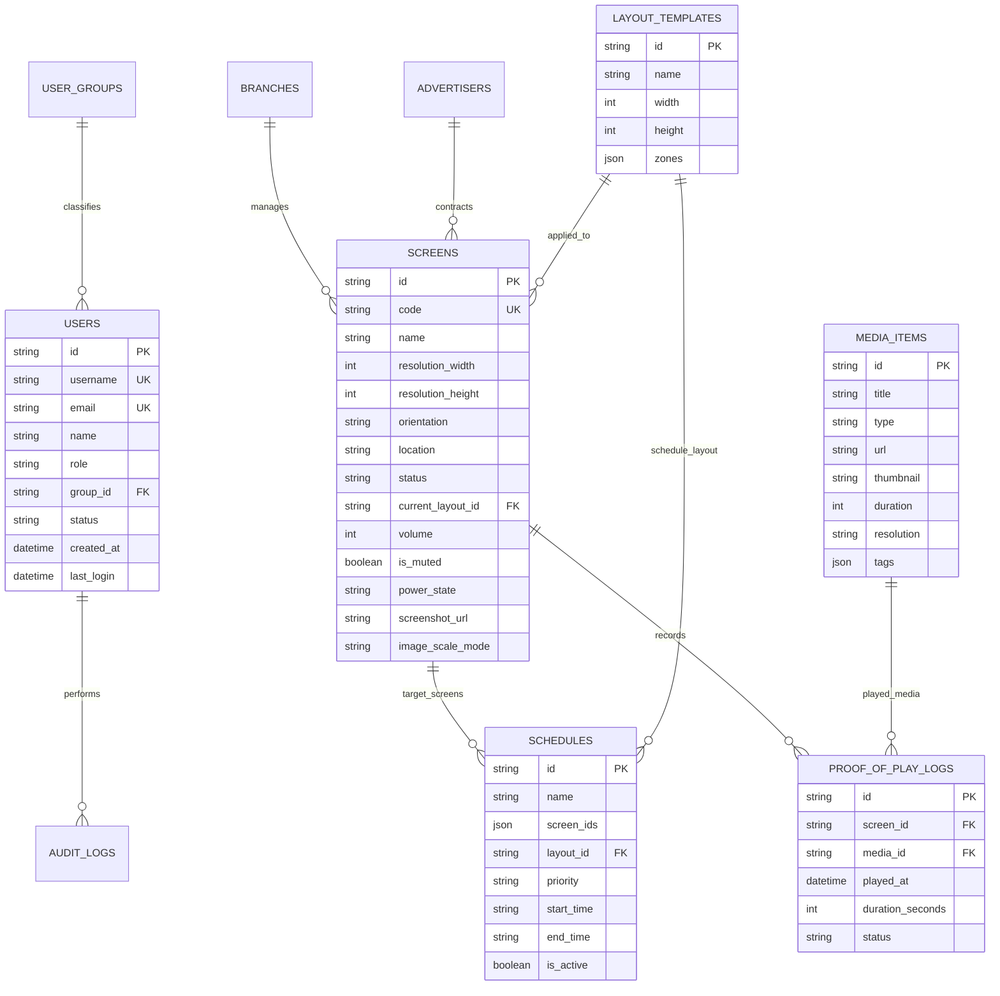

# 🗄️ TÀI LIỆU THIẾT KẾ & HƯỚNG DẪN CƠ SỞ DỮ LIỆU ĐA NỀN TẢNG (UNIVERSAL DATABASE)
### DỰ ÁN: HỆ THỐNG QUẢN TRỊ VÀ TRÌNH CHIẾU MÀN HÌNH LED - LED SIGNAGE CMS PRO

---

## 1. KẾ HOẠCH THIẾT KẾ CƠ SỞ DỮ LIỆU (DATABASE ARCHITECTURE PLAN)

### 1.1. Mục Tiêu Thiết Kế
* **Tính Độc Lập Nền Tảng (Database-Agnostic):** Thiết kế cho phép chạy mượt mà trên bất kỳ CSDL nào (PostgreSQL, MySQL, MariaDB, SQLite, SQL Server, Supabase hoặc MongoDB).
* **Mô Hình Dữ Liệu Lai (Hybrid Relational + JSON):** Các trường thông tin cố định (ID, mã code, tên, trạng thái, thời gian) được chuẩn hóa bảng; các cấu hình linh hoạt (vùng bố cục layout zones, phân quyền chi tiết permissions, tọa độ GPS) được lưu trữ dưới dạng JSON, giúp mở rộng phần cứng mà không cần sửa đổi cấu trúc bảng.
* **Khả Năng Chịu Lỗi (Fault-Tolerance / Offline Resilient):** Hỗ trợ hoạt động cả khi mất kết nối máy chủ dữ liệu nhờ cơ chế Local Cache.

---

### 1.2. Sơ Đồ Thực Thể Quan Hệ (Entity-Relationship Diagram - ERD)



---

## 2. DANH MỤC CÁC FILE DỮ LIỆU ĐÃ TẠO SẴN TRONG THƯ MỤC `database/`

| Tên File | Định Dạng | Mô Tả & Mục Đích Sử Dụng |
| :--- | :--- | :--- |
| **`seed_data.json`** | JSON | Bộ dữ liệu gốc trung lập độc lập nền tảng, chứa toàn bộ 10 thực thể (Users, Screens, Media, Layouts, Schedules, Logs...). Dễ dàng import vào MongoDB, Firebase, Supabase hoặc parse bằng code bất kỳ ngôn ngữ nào. |
| **`init_schema_postgres.sql`** | SQL (PostgreSQL) | Script tạo toàn bộ bảng, khóa chính, kiểu dữ liệu JSONB và Indexes tối ưu cho PostgreSQL / Supabase / Neon / AWS RDS. |
| **`init_schema_mysql.sql`** | SQL (MySQL) | Script tạo toàn bộ bảng chuẩn UTF8MB4 cho MySQL 5.7+, MySQL 8.0+, MariaDB, phpMyAdmin, XAMPP. |
| **`init_schema_sqlite.sql`** | SQL (SQLite) | Script tạo CSDL cục bộ dạng file đơn `.db` cho SQLite, phù hợp chạy ngay trên Windows mà không cần cài server CSDL. |
| **`seed_data.sql`** | SQL (Universal) | Hàng trăm câu lệnh `INSERT INTO` chứa đầy đủ dữ liệu mẫu sẵn sàng nạp vào bất kỳ CSDL quan hệ nào. |
| **`db_tool.cjs`** | Node.js CLI Tool | Công cụ dòng lệnh hỗ trợ thống kê dữ liệu và hướng dẫn chuyển đổi nhanh giữa các CSDL. |

---

## 3. HƯỚNG DẪN CHI TIẾT CÁCH CHUYỂN QUA TỪNG HỆ CSDL

### 🔹 Cách 1: Sử dụng SQLite (Đơn giản nhất, không cần cài server, chạy cục bộ)
Phù hợp nhất khi bạn muốn chạy phần mềm trên 1 máy tính độc lập (Desktop/Laptop) mà không muốn cài đặt phần mềm CSDL nặng nề:
1. Mở Terminal tại thư mục dự án và chạy:
   ```bash
   # Tạo file CSDL SQLite và nạp bảng + dữ liệu mẫu:
   sqlite3 led_cms.db < database/init_schema_sqlite.sql
   sqlite3 led_cms.db < database/seed_data.sql
   ```
2. Kết quả: Tạo ra ngay file `led_cms.db` chứa đầy đủ dữ liệu.

---

### 🔹 Cách 2: Sử dụng PostgreSQL (Khuyến nghị cho Production & Doanh Nghiệp)
1. **Cách nhanh nhất bằng Docker:**
   ```bash
   cd backend
   docker compose up -d
   ```
2. **Nếu đã cài sẵn PostgreSQL hoặc dùng pgAdmin:**
   * Mở pgAdmin hoặc dòng lệnh `psql`:
   * Chạy file schema: `\i database/init_schema_postgres.sql`
   * Nạp dữ liệu mẫu: `\i database/seed_data.sql`

---

### 🔹 Cách 3: Sử dụng MySQL / MariaDB (Dành cho XAMPP, phpMyAdmin, cPanel Hosting)
1. Mở phpMyAdmin:
   * Tạo cơ sở dữ liệu mới: `led_cms` (Collation: `utf8mb4_unicode_ci`).
   * Chọn tab **Import**:
     1. Chọn file `database/init_schema_mysql.sql` và bấm **Go**.
     2. Tiếp tục chọn file `database/seed_data.sql` và bấm **Go**.
2. **Bằng MySQL CLI:**
   ```bash
   mysql -u root -p -e "CREATE DATABASE led_cms CHARACTER SET utf8mb4 COLLATE utf8mb4_unicode_ci;"
   mysql -u root -p led_cms < database/init_schema_mysql.sql
   mysql -u root -p led_cms < database/seed_data.sql
   ```

---

### 🔹 Cách 4: Sử dụng Dữ Liệu JSON (Cho NoSQL / MongoDB / REST API Client)
File `database/seed_data.json` được thiết kế theo cấu trúc REST Collection:
* Bạn có thể nạp thẳng vào MongoDB bằng công cụ `mongoimport`:
  ```bash
  mongoimport --db led_cms --collection screens --file database/seed_data.json --jsonArray
  ```
* Hoặc truyền qua Axios / Fetch API trong frontend/backend trong 1 nốt nhạc.

---

### 🔹 Cách 5: Kiểm tra thông tin bộ dữ liệu bất cứ lúc nào
Chạy lệnh kiểm tra nhanh:
```bash
node database/db_tool.cjs info
```
Lệnh sẽ in ra thống kê chi tiết toàn bộ các bảng và số lượng bản ghi của hệ thống.
